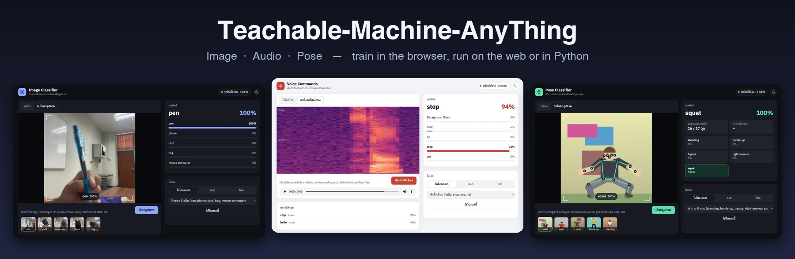
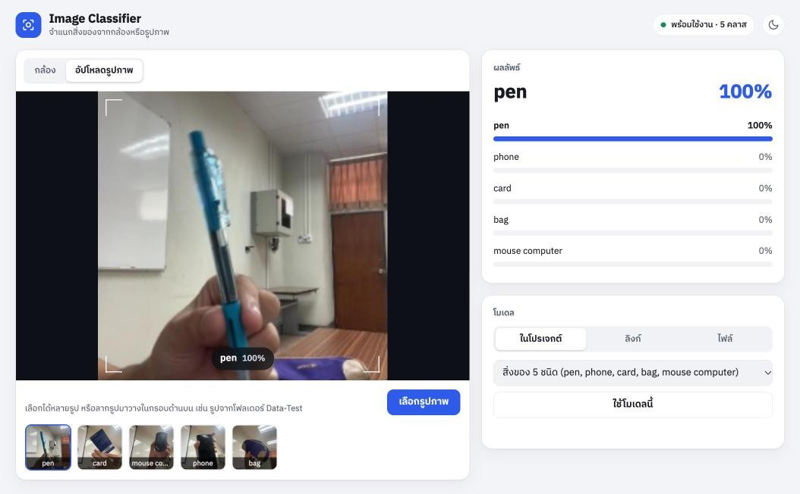
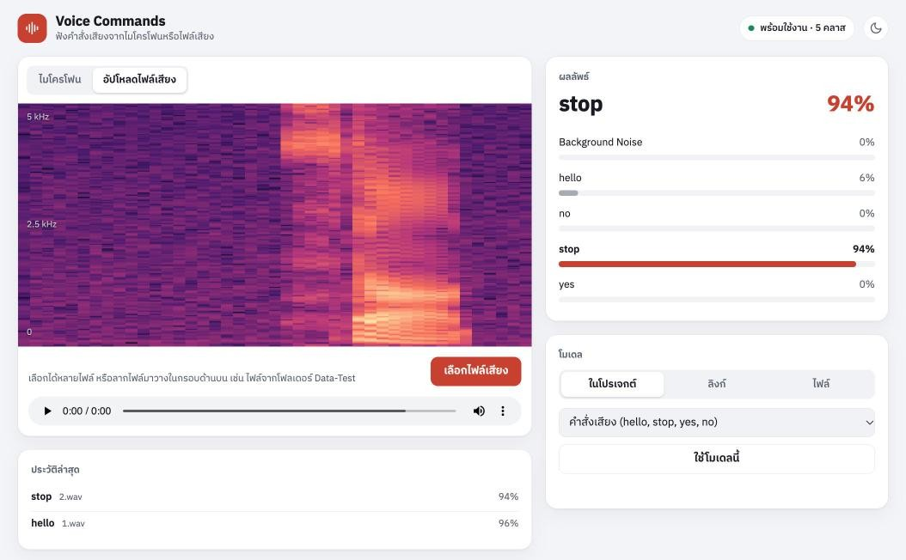
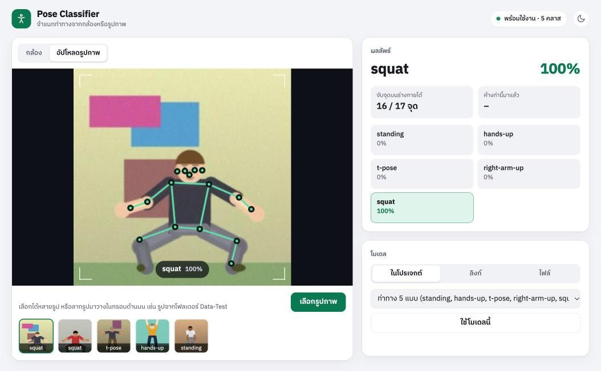
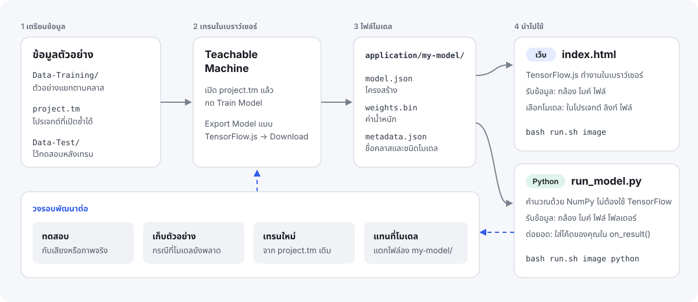
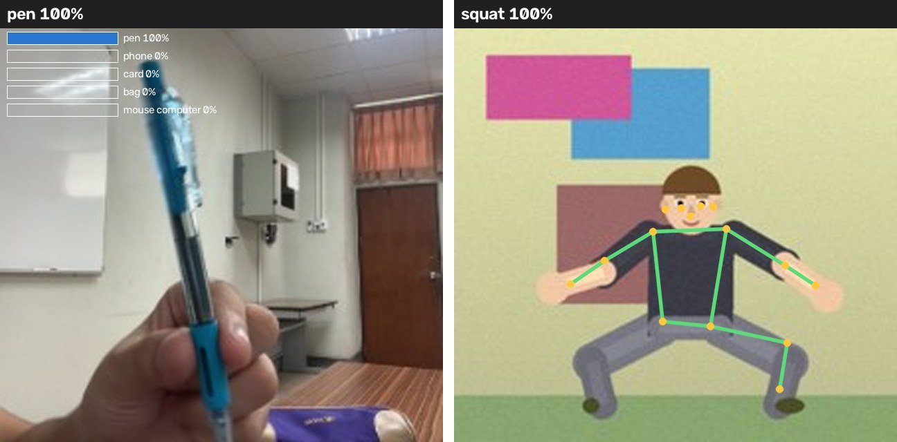
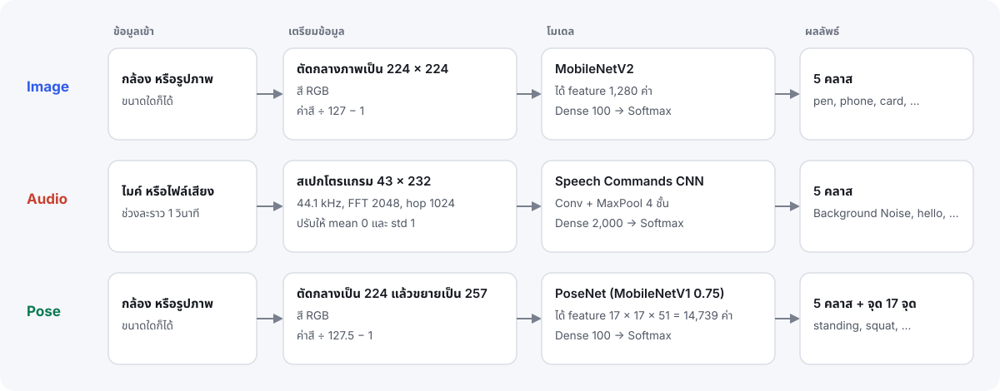

<div align="center">



# Teachable-Machine-AnyThing

**เรียนรู้การสร้างโมเดล AI แบบครบวงจร ตั้งแต่เก็บข้อมูล เทรนบน Teachable Machine จนถึงแอปที่ใช้งานได้จริงบนเว็บและ Python**


[เริ่มใช้งาน](#เริ่มใช้งานใน-1-นาที) · [เปิดบน Colab](#เปิดแอปบน-google-colab) · [ดูแอป](#แอปทั้ง-3-ตัว) · [รันด้วย Python](#รันโมเดลด้วย-python) · [พัฒนาต่อ](#พัฒนาต่อ) · [แก้ปัญหา](#แก้ปัญหาที่พบบ่อย)

</div>

---

## โปรเจกต์นี้คืออะไร

Repo นี้รวม 3 โปรเจกต์ตัวอย่างที่มีโครงสร้างเหมือนกัน แต่ละโปรเจกต์มีครบทั้งข้อมูล โมเดลที่เทรนแล้ว แอปบนเว็บ และสคริปต์ Python

| ชื่อ | สิ่งที่ทำ | คลาส | ข้อมูลเทรน | พอร์ต |
|---|---|---|---|---|
| [**Image**](Image-Project/) | จำแนกสิ่งของ | `pen` `phone` `card` `bag` `mouse computer` | รูปถ่ายจริง คลาสละ 200 รูป | 8001 |
| [**Audio**](Audio-Project/) | ฟังคำสั่งเสียง | `Background Noise` `hello` `stop` `yes` `no` | เสียงสังเคราะห์ คลาสละ 60 คลิป | 8002 |
| [**Pose**](Pose-Project/) | จำแนกท่าทาง | `standing` `hands-up` `t-pose` `right-arm-up` `squat` | ภาพคนจำลอง คลาสละ 100 รูป | 8003 |

> [!IMPORTANT]
> โมเดล **Audio** และ **Pose** ที่มากับ repo เทรนจากข้อมูลสังเคราะห์ เหมาะสำหรับเรียนรู้และทดลองระบบ ถ้าจะใช้กับเสียงหรือคนจริง ให้[เก็บตัวอย่างจริงแล้วเทรนใหม่](#เทรนโมเดลใหม่)ก่อน

## เริ่มใช้งานใน 1 นาที

ต้องมี **Python 3.9 ขึ้นไป** (ทดสอบแล้วกับ 3.9 และ 3.10) และอินเทอร์เน็ต

```bash
git clone https://github.com/bluebox-dev/Teachable-Machine-AnyThing.git
```

```bash
cd Teachable-Machine-AnyThing
```

```bash
bash install.sh
```

```bash
bash run.sh image
```

เบราว์เซอร์จะเปิดแอปให้เอง เปลี่ยน `image` เป็น `audio` หรือ `pose` เพื่อเปิดแอปอื่น

| ระบบ | ติดตั้ง | เปิดแอปบนเว็บ |
|---|---|---|
| macOS | `bash install.sh` | `bash run.sh image` หรือดับเบิลคลิก `application/run.command` |
| Linux | `bash install.sh` | `bash run.sh image` |
| Windows (Git Bash หรือ WSL) | `bash install.sh` | `bash run.sh image` |
| Windows (ไม่มี Git Bash) | ดับเบิลคลิก `install.bat` | ดับเบิลคลิก `application\run.bat` |

> [!TIP]
> แอปบนเว็บใช้แค่ Python ไม่ต้องติดตั้งไลบรารีเพิ่ม ขั้นตอน `install.sh` จำเป็นสำหรับ `run_model.py` โดยจะสร้าง environment ที่ `.venv` และติดตั้ง `numpy`, `opencv-python`, `sounddevice`

ถ้าเครื่องมี Python หลายเวอร์ชัน ให้ระบุเวอร์ชันที่ต้องการ เช่น 3.10 สคริปต์จะสร้าง `.venv` ใหม่ให้เองเมื่อเวอร์ชันไม่ตรงกับของเดิม

```bash
bash install.sh python3.10
```

บน Windows ใช้ `bash install.sh "py -3.10"` หรือ `install.bat 3.10` และไม่ควรคัดลอกโฟลเดอร์ `.venv` ข้ามเครื่อง ให้รันคำสั่งติดตั้งใหม่ในเครื่องนั้นแทน

## เปิดแอปบน Google Colab

ถ้าไม่อยากติดตั้งอะไรในเครื่อง เปิดแอปผ่าน Colab ได้ โดยแต่ละโปรเจกต์มี notebook ของตัวเอง

| แอป | Notebook | เปิดใช้งาน |
|---|---|---|
| Image Classifier | [`Image-Classifier-Colab.ipynb`](Image-Project/Image-Classifier-Colab.ipynb) | [](https://colab.research.google.com/github/bluebox-dev/Teachable-Machine-AnyThing/blob/main/Image-Project/Image-Classifier-Colab.ipynb) |
| Voice Commands | [`Voice-Commands-Colab.ipynb`](Audio-Project/Voice-Commands-Colab.ipynb) | [](https://colab.research.google.com/github/bluebox-dev/Teachable-Machine-AnyThing/blob/main/Audio-Project/Voice-Commands-Colab.ipynb) |
| Pose Classifier | [`Pose-Classifier-Colab.ipynb`](Pose-Project/Pose-Classifier-Colab.ipynb) | [](https://colab.research.google.com/github/bluebox-dev/Teachable-Machine-AnyThing/blob/main/Pose-Project/Pose-Classifier-Colab.ipynb) |

1. กดปุ่ม **Open in Colab** ของแอปที่ต้องการ แล้วลงชื่อเข้าใช้บัญชี Google
2. กดปุ่ม ▶ ที่เซลล์โค้ด ถ้า Colab เตือนว่า notebook ไม่ได้สร้างโดย Google ให้กด **Run anyway**
3. รอให้ notebook ดาวน์โหลด repo (ราว 170 MB) แอปจะแสดงใต้เซลล์นั้น

ไม่ต้องใช้ GPU เพราะโมเดลทำงานในเบราว์เซอร์ Colab ทำหน้าที่ส่งไฟล์ของแอปเท่านั้น และกล้องกับไมค์ที่ใช้คือของเครื่องคุณ

> [!NOTE]
> Notebook จะ clone โค้ดจาก branch หลักของ repo นี้บน GitHub จึงเห็นเฉพาะสิ่งที่ push แล้ว ถ้า fork ไปพัฒนาต่อ ให้แก้ค่า `REPO_URL` ในเซลล์โค้ด

## แอปทั้ง 3 ตัว

ทุกแอปเลือกโมเดลได้ 3 แบบ (ในโปรเจกต์ ลิงก์ หรืออัปโหลดไฟล์) โดยโมเดลจะเปลี่ยนทันทีที่เลือก และจำลิงก์ล่าสุดไว้ใช้ครั้งถัดไป รับข้อมูลจากกล้องหรือไมค์ ลากไฟล์มาวางได้ รองรับโหมดสว่าง/มืดและหน้าจอมือถือ และจะเตือนเมื่อเลือกโมเดลผิดชนิด

### Image Classifier

กรอบบนภาพแสดงพื้นที่ที่โมเดลเห็นจริง อัปโหลดได้หลายรูปพร้อมกันและกดดูย้อนหลังจากแถบด้านล่าง

<picture>
  <source media="(prefers-color-scheme: dark)" srcset="docs/images/app-image-dark.jpg">
  
</picture>

### Voice Commands

แสดงสเปกโตรแกรมพร้อมแกนความถี่ ปรับความมั่นใจขั้นต่ำกับ overlap factor ได้ และมีประวัติคำที่ตรวจพบ

<picture>
  <source media="(prefers-color-scheme: dark)" srcset="docs/images/app-audio-dark.jpg">
  
</picture>

### Pose Classifier

วาดโครงร่างบนภาพ แสดงจำนวนจุดบนร่างกายที่จับได้ และจับเวลาว่าค้างท่าปัจจุบันมานานเท่าไร

<picture>
  <source media="(prefers-color-scheme: dark)" srcset="docs/images/app-pose-dark.jpg">
  
</picture>

## ภาพรวมระบบ

ทุกโปรเจกต์ใช้เส้นทางเดียวกัน: เตรียมข้อมูล เทรนในเบราว์เซอร์ export ไฟล์โมเดล แล้วนำไปใช้ได้ทั้งบนเว็บและ Python โดยใช้ไฟล์โมเดลชุดเดียวกัน



## โครงสร้างโปรเจกต์

```text
Teachable-Machine-AnyThing/
├── install.sh              # ติดตั้งบน macOS, Linux, Windows (Git Bash/WSL)
├── install.bat             # ติดตั้งบน Windows ที่ไม่มี Git Bash
├── run.sh                  # เปิดแอปเว็บหรือรัน Python ทุกโปรเจกต์
├── requirements.txt        # ไลบรารี Python
├── docs/images/            # ภาพประกอบใน README
│
├── Image-Project/          # Audio-Project/ และ Pose-Project/ มีโครงสร้างเดียวกัน
│   ├── Data-Training/      # ข้อมูลเทรน แยกโฟลเดอร์ตามคลาส
│   ├── Data-Test/          # ข้อมูลทดสอบ
│   ├── Model/              # โมเดลที่ export จาก Teachable Machine (.zip)
│   ├── project.tm          # โปรเจกต์ที่เปิดซ้ำบน Teachable Machine ได้
│   ├── Image-Classifier-Colab.ipynb  # เปิดแอปบน Google Colab (ชื่อไฟล์ตามแอปของโปรเจกต์นั้น)
│   └── application/
│       ├── index.html      # หน้าแอป
│       ├── app.js          # การทำงานของแอป
│       ├── style.css       # หน้าตาและธีมสี
│       ├── run_model.py    # รันโมเดลด้วย Python
│       ├── my-model/       # โมเดลที่แอปใช้ (model.json, metadata.json, weights.bin)
│       ├── run.command     # ดับเบิลคลิกบน macOS
│       ├── run.bat         # ดับเบิลคลิกบน Windows
│       └── README.md       # คู่มือสั้นของแอปนั้น
```

ส่วนที่ต่างกันเล็กน้อยระหว่างโปรเจกต์:

- `Audio-Project/Data-Training/` มีไฟล์ `<คลาส>-samples.zip` สำหรับอัปโหลดเข้า Teachable Machine เพราะหน้าเว็บรับเสียงแบบ zip เท่านั้น
- `Pose-Project/application/posenet/` เก็บโมเดล PoseNet ที่ `run_model.py` ใช้

## รันโมเดลด้วย Python

แต่ละโปรเจกต์มี `application/run_model.py` หนึ่งไฟล์ อ่านโมเดล TensorFlow.js ได้โดยตรงและคำนวณด้วย NumPy จึงไม่ต้องติดตั้ง TensorFlow

```bash
bash run.sh image python
```

```bash
bash run.sh image python --source Image-Project/Data-Test
```

```bash
bash run.sh audio python --source Audio-Project/Data-Test
```

```bash
bash run.sh pose python --source Pose-Project/Data-Test
```

ไม่ใส่ `--source` จะเปิดกล้อง (Image, Pose) หรือไมโครโฟน (Audio) บน Windows ที่ไม่มี Git Bash ให้รันโดยตรงด้วย `.venv\Scripts\python.exe Image-Project\application\run_model.py`

ตัวอย่างผลลัพธ์จริงจากคำสั่งของ Image:

```text
โหลดโมเดลแล้ว: pen, phone, card, bag, mouse computer
1.jpg: card 100.0%
ตรวจพบ: card (100%)
2.jpg: mouse computer 100.0%
ตรวจพบ: mouse computer (100%)
```

เมื่อตั้งค่า `SAVE_DIR` หรือเปิดหน้าต่างกล้อง สคริปต์จะวาดผลลงบนภาพแบบนี้:



### ปรับแต่งที่หัวไฟล์

เปิด `run_model.py` แล้วแก้ค่าในส่วน **ตั้งค่า** ได้เลย หรือส่งเป็นตัวเลือกตอนรัน (ดูทั้งหมดด้วย `--help`)

| ค่า | ตัวเลือกตอนรัน | ความหมาย | ใช้กับ |
|---|---|---|---|
| `MODEL` | `--model` | โฟลเดอร์, ไฟล์ `.zip` หรือลิงก์ของโมเดล | ทุกโปรเจกต์ |
| `SOURCE` | `--source` | `webcam` หรือ `mic`, ไฟล์ หรือโฟลเดอร์ | ทุกโปรเจกต์ |
| `MIN_CONFIDENCE` | `--min-confidence` | ความมั่นใจขั้นต่ำ 0–1 | ทุกโปรเจกต์ |
| `CAMERA_INDEX` | `--camera` | เลขกล้อง | Image, Pose |
| `FLIP_CAMERA` | – | กลับภาพซ้าย-ขวา | Image, Pose |
| `SHOW_WINDOW` | `--no-window` | เปิดหรือปิดหน้าต่างกล้อง | Image, Pose |
| `SAVE_DIR` | – | โฟลเดอร์สำหรับบันทึกรูปพร้อมผล | Image, Pose |
| `SHOW_SKELETON`, `MIN_PART_CONFIDENCE` | – | การวาดโครงร่าง | Pose |
| `MIC_DEVICE` | `--mic`, `--list-mics` | เลือกไมโครโฟน | Audio |
| `OVERLAP` | `--overlap` | 0–0.75 ยิ่งมากยิ่งทำนายถี่และจับคำได้ครบขึ้น | Audio |
| `COOLDOWN_SECONDS`, `IGNORE_LABELS` | – | กันแจ้งคำซ้ำ และคลาสที่ไม่ต้องแจ้ง | Audio |

### ต่อยอดด้วย `on_result`

ฟังก์ชันนี้ถูกเรียกเมื่อโมเดลตรวจพบผลที่มั่นใจเกิน `MIN_CONFIDENCE` ใส่โค้ดของคุณแทนที่ฟังก์ชันเดิมได้เลย

<details>
<summary><b>Image:</b> บันทึกผลลงไฟล์ CSV</summary>

```python
import csv
from datetime import datetime


def on_result(label, confidence):
    with open("results.csv", "a", newline="", encoding="utf-8") as file:
        csv.writer(file).writerow([datetime.now().isoformat(timespec="seconds"), label, f"{confidence:.3f}"])
```

</details>

<details>
<summary><b>Audio:</b> สั่งงานตามคำที่ได้ยิน</summary>

```python
ACTIONS = {
    "hello": lambda: print("สวัสดีครับ"),
    "stop": lambda: print("หยุดการทำงาน"),
}


def on_result(label, confidence):
    action = ACTIONS.get(label)
    if action:
        action()
```

</details>

<details>
<summary><b>Pose:</b> นับจำนวนครั้งและอ่านตำแหน่งบนร่างกาย</summary>

`keypoints` มี 17 จุด เช่น `nose`, `leftShoulder`, `rightWrist`, `leftAnkle` แต่ละจุดเป็น `(x, y, ความมั่นใจ)`

```python
squat_count = 0


def on_result(label, confidence, keypoints):
    global squat_count
    if label == "squat":
        squat_count += 1
        print(f"squat ครั้งที่ {squat_count}")

    x, y, score = keypoints["rightWrist"]
    if score > 0.5:
        print(f"ข้อมือขวาอยู่ที่ ({x:.0f}, {y:.0f})")
```

</details>

### เรียกใช้จากโค้ดของคุณเอง

รันจากโฟลเดอร์ `application` ของแต่ละโปรเจกต์

```python
# Image
import cv2
from run_model import TeachableModel, describe

model = TeachableModel("my-model")
scores = model.predict(cv2.imread("../Data-Test/3.jpg"))
print(describe(model, scores))  # ('pen', 1.0)
```

```python
# Pose: predict คืนทั้งคะแนนและจุดบนร่างกาย
import cv2
from run_model import TeachableModel, describe

model = TeachableModel("my-model")
scores, keypoints = model.predict(cv2.imread("../Data-Test/5.jpg"))
print(describe(model, scores), keypoints["nose"])
```

```python
# Audio
import run_model as rm

model = rm.TeachableModel("my-model")
frames = rm.loudest_window(rm.to_frames(rm.read_wav("../Data-Test/2.wav")))
print(dict(zip(model.labels, model.predict(frames))))
```

## หลักการทำงาน



จุดสำคัญที่สุดเวลาแก้โค้ดคือ **การเตรียมข้อมูลต้องตรงกับตอนเทรนทุกขั้นตอน** ถ้าต่างกัน โมเดลจะยังรันได้ แต่ผลจะแย่ลงโดยไม่มี error

| ไฟล์ | หน้าที่ | รายละเอียด |
|---|---|---|
| `model.json` | โครงสร้างโมเดลและรายการน้ำหนัก | `run_model.py` อ่านแล้วคำนวณทีละเลเยอร์ |
| `weights.bin` หรือ `model.weights.bin` | ค่าน้ำหนักแบบ `float32` ต่อกัน | ตัดตาม `shape` ที่ระบุใน `model.json` |
| `metadata.json` | ชื่อคลาสและชนิดโมเดล | ชื่อคลาสอยู่ใน `labels` หรือ `wordLabels` (Audio) |
| `project.tm` | ไฟล์ zip ของโปรเจกต์ | ตัวอย่างชื่อ `<คลาส>-!-<เลข>` และ `manifest.json` |

> [!NOTE]
> เว็บและ Python ให้ผลจำแนกใกล้เคียงกัน แต่จุดบนร่างกายของ Pose อาจต่างกันบางจุด เพราะเว็บใช้การถอดรหัสแบบหลายคนตามไลบรารีของ Teachable Machine ส่วน Python เลือกจุดที่คะแนนสูงสุดของแต่ละส่วน จึงมักแสดงจุดได้มากกว่า

## พัฒนาต่อ

### อยากแก้อะไร ไปที่ไหน

| อยากทำ | แก้ที่ |
|---|---|
| เปลี่ยนสีหรือหน้าตาแอป | `--accent` และตัวแปรอื่นใน `:root` ของ `style.css` |
| เพิ่มโมเดลในรายการของแอป | อาร์เรย์ `BUILT_IN_MODELS` ต้นไฟล์ `app.js` |
| เปลี่ยนเกณฑ์ "ไม่แน่ใจ" บนเว็บ | ค่า `MIN_CONFIDENCE` ต้นไฟล์ `app.js` (Image, Pose) |
| เพิ่มการทำงานเมื่อตรวจพบผลใน Python | ฟังก์ชัน `on_result` ใน `run_model.py` |
| รองรับเลเยอร์ชนิดใหม่ใน Python | เมธอด `forward` ใน `run_model.py` |
| เปลี่ยนพอร์ต | `run.sh`, `run.command` และ `run.bat` |

> [!TIP]
> เมื่อแก้ `style.css` หรือ `app.js` ให้เพิ่มเลข `?v=` ใน `index.html` ด้วย หรือกด `Cmd+Shift+R` / `Ctrl+Shift+R` เพราะเบราว์เซอร์อาจใช้ไฟล์เก่าจาก cache

### เทรนโมเดลใหม่

1. เปิด [Teachable Machine](https://teachablemachine.withgoogle.com/train) กด **Open an existing project from a file** แล้วเลือก `project.tm` ของโปรเจกต์นั้น
2. เพิ่มตัวอย่างด้วยปุ่ม **Webcam** หรือ **Mic** และเพิ่มหรือเปลี่ยนชื่อคลาสได้ตามต้องการ โดย Audio ต้องมี Background Noise อย่างน้อย 20 ตัวอย่าง และคลาสอื่นอย่างน้อย 8 ตัวอย่าง
3. กด **Train Model** และเปิดแท็บค้างไว้จนเทรนเสร็จ
4. กด **Export Model** แล้วเลือก **Tensorflow.js → Download → Download my model**
5. แตกไฟล์ทับโมเดลเดิม และเก็บไฟล์ zip ไว้ใน `Model/` (ชื่อไฟล์อาจต่างกันตามชื่อโมเดล)

   ```bash
   unzip -o ~/Downloads/tm-my-image-model.zip -d Image-Project/application/my-model
   ```

6. เปิดเมนู **☰ → Download project as file** แล้วเก็บเป็น `project.tm` ของโปรเจกต์นั้น เพื่อใช้เทรนต่อครั้งหน้า
7. ถ้าเปลี่ยนคลาส ให้แก้ชื่อที่แสดงใน `BUILT_IN_MODELS` ของ `app.js` ส่วนแถบผลลัพธ์และ `run_model.py` จะอ่านคลาสจาก `metadata.json` เอง

> [!NOTE]
> ใช้ **Upload my model** ถ้าอยากได้ลิงก์แชร์ แล้วนำลิงก์ไปวางในแอป หรือส่งผ่าน `--model` โมเดลจะถูกเก็บบนบริการของ Teachable Machine

### แนวทางต่อยอด

- **เก็บข้อมูลจริง** สำหรับ Audio และ Pose เป็นสิ่งแรกที่ควรทำ เพราะเพิ่มความแม่นยำได้มากที่สุด
- **เพิ่มตัวอย่างใน `right-arm-up`** ซึ่งเป็นคลาสที่อ่อนที่สุดของโมเดล Pose
- **สร้างแอปเฉพาะทาง** เช่น นับท่าออกกำลังกายจาก `keypoints` หรือสั่งงานอุปกรณ์ด้วยเสียงผ่าน `on_result`
- **เพิ่มชุดทดสอบอัตโนมัติ** ที่รัน `Data-Test` แล้วเทียบกับเฉลย เพื่อตรวจว่าโมเดลใหม่ไม่แย่ลง
- **ทำให้เว็บทำงานแบบออฟไลน์** โดยเก็บไลบรารีไว้ในโปรเจกต์แทนการโหลดจาก CDN
- **รวมโค้ดที่ซ้ำกัน** ใน `run_model.py` ทั้ง 3 ไฟล์เป็นโมดูลกลาง ถ้าไม่จำเป็นต้องให้แต่ละไฟล์ใช้แยกกันได้

## ผลทดสอบ

### ความแม่นยำ

| โมเดล | ชุดทดสอบ | ผล | หมายเหตุ |
|---|---|---|---|
| Image | `Data-Test` 5 รูป | 5/5 | ชุดทดสอบเล็ก ควรเพิ่มรูปก่อนสรุปความแม่นยำ |
| Audio | `Data-Test` 10 ไฟล์ | 9/10 | ใช้เสียงสังเคราะห์ที่ไม่ได้ใช้เทรน |
| Pose | `Data-Test` 10 รูป | 8/10 | ข้อที่ผิดคือ `right-arm-up` ทั้ง 2 รูป |
| Pose | ภาพจำลองชุดใหม่ 100 รูป | 95/100 | สร้างจากโปรแกรมเดียวกับข้อมูลเทรน |

ตัวเลขเหล่านี้วัดกับข้อมูลใน repo เท่านั้น ยังไม่สะท้อนความแม่นกับเสียงหรือคนจริงของ Audio และ Pose

<details>
<summary>เฉลยของ <code>Data-Test</code></summary>

| ไฟล์ | Image | Audio | Pose |
|---|---|---|---|
| 1 | card | hello | standing |
| 2 | mouse computer | stop | hands-up |
| 3 | pen | yes | t-pose |
| 4 | phone | no | right-arm-up |
| 5 | bag | Background Noise | squat |
| 6 | – | hello | standing |
| 7 | – | stop | hands-up |
| 8 | – | yes | t-pose |
| 9 | – | no | right-arm-up |
| 10 | – | Background Noise | squat |

</details>

### ความเร็วของ `run_model.py`

วัดบน Apple M2 ด้วย Python 3.9 และ NumPy 2.0 นับเฉพาะเวลาคำนวณของโมเดล ไม่รวมการอ่านกล้องและการวาดภาพ

| โมเดล | เวลาต่อการทำนาย |
|---|---|
| Image | ราว 19 ms |
| Pose | ราว 30 ms |
| Audio | ราว 2 ms |

### สถานะการทดสอบ

| รายการ | สถานะ |
|---|---|
| ติดตั้งและรันบน macOS | ✅ ทดสอบแล้วกับ Python 3.9 และ 3.10 |
| แอปเว็บกับไฟล์ทดสอบ | ✅ ทดสอบแล้ว |
| แอปเว็บกับลิงก์โมเดลจริง | ✅ ทดสอบกับโมเดลสาธารณะบน Teachable Machine ครบ 3 ชนิด ทั้งการวางลิงก์ การรีเฟรช และการอัปโหลดไฟล์ |
| แอปเว็บกับกล้องและไมค์ | ⚠️ ทดสอบด้วยสตรีมจำลอง ยังไม่ได้ลองกับอุปกรณ์จริง |
| Notebook บน Colab | ⚠️ รันโค้ดของ notebook โดยจำลอง `google.colab` และเปิดแอปใน iframe ครบ 3 ตัวแล้ว ยังไม่ได้รันบน Colab จริง และยังไม่ได้ลองกล้องกับไมค์ผ่าน Colab |
| ผล Python เทียบกับเว็บ | ✅ Image ตรงกันใน 4 หลัก, Audio ต่างไม่เกิน 0.9 จุดเปอร์เซ็นต์ และ Pose ตรงกันใน 4 หลักเมื่อใช้ไฟล์ PNG (ไฟล์ JPEG อาจต่างกันเพราะ Chrome กับ OpenCV ถอดรหัสไม่เหมือนกัน) |
| `run_model.py` กับกล้องและไมค์ | ⚠️ ยังไม่ได้ทดสอบการจับภาพหรือเสียงจริง โดยไมค์เปิดได้ และเครื่องทดสอบไม่ได้อนุญาตกล้องให้ Terminal (Audio ทดสอบการตรวจคำแบบต่อเนื่องด้วยเสียงจากไฟล์) |
| Linux และ Windows | ⚠️ ยังไม่ได้รันจริง ตรวจเฉพาะไวยากรณ์ของ `install.sh` และ `run.sh` |

## ข้อจำกัดที่ควรรู้

- เว็บต้องต่ออินเทอร์เน็ตเพื่อโหลดไลบรารี ฟอนต์ และ PoseNet
- กล้องและไมค์บนเว็บทำงานเฉพาะ `localhost` หรือ HTTPS จึงเปิดไฟล์ HTML ตรง ๆ ไม่ได้
- บน Colab แอปแสดงได้เฉพาะในหน้า notebook ขณะ runtime ทำงานอยู่ จึงเปิดในแท็บอื่นหรือแชร์ลิงก์ให้คนอื่นไม่ได้
- `run_model.py` ของ Audio อ่านได้เฉพาะไฟล์ `.wav` ส่วนแอปเว็บอ่านรูปแบบเสียงที่เบราว์เซอร์รองรับ
- `run_model.py` รองรับเฉพาะโมเดลแบบ TensorFlow.js ยังไม่รองรับไฟล์ Keras (`.h5`)
- ชื่อคลาสภาษาไทยในหน้าต่างกล้องของ Python จะแสดงเป็น `???` เพราะข้อจำกัดของ OpenCV แต่ใน Terminal และบนเว็บแสดงได้ปกติ
- โค้ด PoseNet ฝั่ง Python รองรับเฉพาะรุ่น MobileNetV1 0.75 stride 16 ซึ่งเป็นค่าที่ Teachable Machine ใช้ในโมเดลชุดนี้

## แก้ปัญหาที่พบบ่อย

| อาการ | วิธีแก้ |
|---|---|
| `ไม่พบ Python` | macOS: `brew install python` · Ubuntu: `sudo apt install python3 python3-venv` · Windows: `winget install Python.Python.3.12` |
| เปิดกล้องหรือไมค์ไม่ได้บนเว็บ | กดอนุญาตในเบราว์เซอร์ และเปิดผ่าน `http://localhost:<พอร์ต>/` |
| เปิดกล้องหรือไมค์ไม่ได้บน Colab | กดอนุญาตที่ไอคอนด้านซ้ายของแถบที่อยู่ในเบราว์เซอร์ แล้วรันเซลล์อีกครั้ง แนะนำให้ใช้ Google Chrome |
| แอปบน Colab หายหรือขึ้นหน้าว่าง | Colab อาจตัดการเชื่อมต่อเมื่อไม่ได้ใช้งานนาน ให้รันเซลล์อีกครั้ง |
| แอปบน Colab ถูกตัดขอบ | เพิ่มค่า `APP_HEIGHT` ในเซลล์โค้ด แล้วรันอีกครั้ง |
| Python เปิดกล้องหรือไมค์ไม่ได้บน macOS | เปิด System Settings → Privacy & Security แล้วอนุญาตให้ Terminal ใช้กล้องและไมโครโฟน |
| มีกล้องหลายตัวแล้วเปิดผิดตัว | ลอง `--camera 1` และบนเว็บเลือกจากรายการกล้อง |
| `ไม่พบไลบรารีเสียงของระบบ` บน Linux | `sudo apt install libportaudio2` |
| `ใช้งาน OpenCV ไม่ได้` บน Linux | `sudo apt install libgl1 libglib2.0-0` |
| `Address already in use` | ปิดโปรแกรมเดิมที่ใช้พอร์ตนั้น หรือเปลี่ยนค่า `PORT` |
| หน้าเว็บยังเป็นแบบเก่าหลังแก้ไฟล์ | กด `Cmd+Shift+R` หรือ `Ctrl+Shift+R` |
| วางลิงก์แล้วขึ้น `ไม่พบโมเดลที่ลิงก์นี้` | ตรวจว่าคัดลอกลิงก์มาครบ และเปิด `<ลิงก์>/metadata.json` ได้ |
| `โมเดลนี้เป็นชนิด ...` | โมเดลไม่ตรงกับแอป เช่น นำโมเดล Pose ไปใช้กับ Image ให้เลือกโมเดลชนิดที่ถูกต้อง |
| `ยังไม่รองรับเลเยอร์ ...` | เพิ่มการคำนวณเลเยอร์นั้นในเมธอด `forward` ของ `run_model.py` |
| ดาวน์โหลด PoseNet ไม่สำเร็จ | ตรวจอินเทอร์เน็ต หรือรัน `Install Certificates.command` ของ Python บน macOS |
| ผลทำนายผิดบ่อยกับของจริง | [เก็บตัวอย่างในสภาพแวดล้อมจริงแล้วเทรนใหม่](#เทรนโมเดลใหม่) |

## เครดิต

- [Teachable Machine](https://teachablemachine.withgoogle.com/) และ [teachablemachine-community](https://github.com/googlecreativelab/teachablemachine-community) โดย Google
- [TensorFlow.js](https://github.com/tensorflow/tfjs), [PoseNet และ Speech Commands](https://github.com/tensorflow/tfjs-models)
- [NumPy](https://numpy.org/), [OpenCV](https://opencv.org/), [python-sounddevice](https://python-sounddevice.readthedocs.io/)

**สัญญาอนุญาต:** ยังไม่ได้กำหนด ถ้าต้องการเปิดให้ผู้อื่นนำไปใช้ต่อ ควรเพิ่มไฟล์ `LICENSE`
